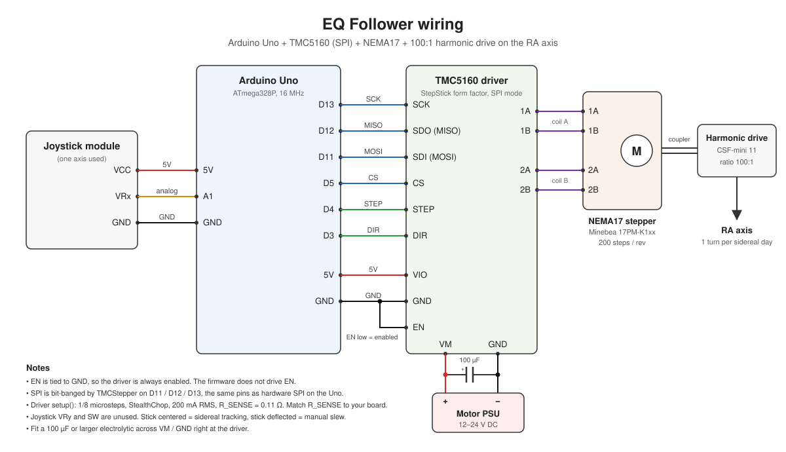

# EQ_Follower

DIY simple equatorial mount auto follower based on Arduino.


The RA axis is driven by a NEMA17 stepper through a 100:1 harmonic drive. With the joystick centered the firmware steps the motor at sidereal rate. Deflecting the joystick slews the axis in either direction, with speed proportional to deflection.

## Parts

| Part | Notes |
|---|---|
| Arduino Uno (ATmega328P) | Runs the firmware. Only the `uno` PlatformIO env is set up with the driver library. |
| TMC5160 stepper driver | StepStick form factor, used in SPI mode. Sense resistor in the firmware is 0.11 Ω, change `R_SENSE` to match your board (many TMC5160 boards use 0.075 Ω). |
| NEMA17 stepper motor | Minebea 17PM-K1xx, 200 steps per revolution. |
| Harmonic drive | CSF-mini 11, ratio 100:1. Coupled directly to the motor shaft, no belt. Output is the RA axis. |
| Analog joystick module | Only one axis (VRx) is read. VRy and the button are unused. |
| Motor power supply | 12–24 V DC into the driver's VM, within your driver board's rating. Fit a 100 µF or larger electrolytic across VM / GND at the driver. |
| Equatorial mount | RA axis turned directly by the harmonic drive output. |

## Wiring



### Pinout

| Arduino pin | Signal | Connects to |
|---|---|---|
| D3 | DIR | TMC5160 DIR |
| D4 | STEP | TMC5160 STEP |
| D5 | CS | TMC5160 CS |
| D11 | MOSI | TMC5160 SDI |
| D12 | MISO | TMC5160 SDO |
| D13 | SCK | TMC5160 SCK |
| A1 | Joystick axis | Joystick VRx |
| 5V | Logic supply | TMC5160 VIO, joystick VCC |
| GND | Ground | TMC5160 GND, TMC5160 EN, joystick GND |

| TMC5160 pin | Connects to |
|---|---|
| 1A, 1B | Motor coil A |
| 2A, 2B | Motor coil B |
| VM | Motor PSU + |
| GND | Motor PSU − |
| EN | GND (driver always enabled, the firmware does not control it) |

SPI is bit-banged by the TMCStepper library on D11 / D12 / D13, which happen to be the hardware SPI pins on the Uno.

### Driver settings

Set in `setup()`:

| Setting | Value |
|---|---|
| Microsteps | 1/8 |
| RMS current | 200 mA |
| Chopper | StealthChop (`en_pwm_mode`) |
| R_SENSE | 0.11 Ω |

## How the tracking rate is derived

The RA axis needs one turn per sidereal day, 86164.0905 s.

```
steps per sidereal day = 100 (harmonic) × 200 (full steps) × 8 (microsteps) = 160 000
step period            = 86164.0905 s / 160 000 = 538.526 ms
```

Steps are scheduled on `micros()` rather than with blocking delays, so the joystick keeps being read between steps and loop overhead does not stretch the period.

## Manual mode

The joystick axis is mapped to −1000…+1000. Inside ±80 the stick counts as centered and the mount tracks. Outside that range the sign sets the direction and the step period is mapped linearly from about 5.5 ms at the edge of the dead zone down to about 0.5 ms at full deflection, roughly 1000× sidereal.

## Build and upload

Requires [PlatformIO](https://platformio.org/). Set `upload_port` and `monitor_port` in `platformio.ini` to the port your board shows up on, then:

```
pio run -e uno -t upload
pio device monitor
```
